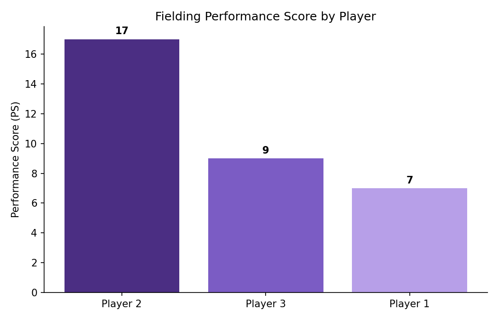
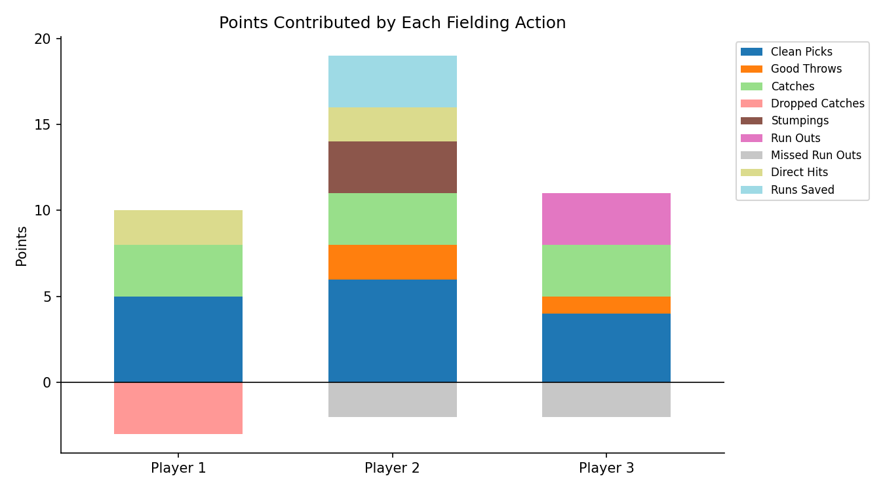
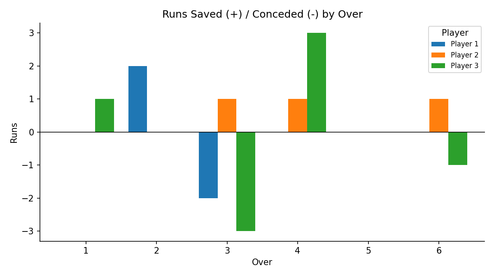

# Cricket Fielding Analysis Report

**Match:** SAMPLE-001  |  **Fielding team:** Team A  |  **Venue:** Sample Stadium, City  |  **Fielding actions recorded:** 22

## 1. Performance Matrix

| Player | CP | GT | C | DC | ST | RO | MRO | DH | RS | **PS** |
|---|---|---|---|---|---|---|---|---|---|---|
| Player 1 | 5 | 0 | 1 | 1 | 0 | 0 | 0 | 1 | 0 | **7** |
| Player 2 | 6 | 2 | 1 | 0 | 1 | 0 | 1 | 1 | 3 | **17** |
| Player 3 | 4 | 1 | 1 | 0 | 0 | 1 | 1 | 0 | 0 | **9** |

Weights: CP +1, GT +1, C +3, DC -3, ST +3, RO +3, MRO -2, DH +2, RS added as it is.

## 2. Ranking

1. **Player 2** - 17 points
2. **Player 3** - 9 points
3. **Player 1** - 7 points

## 3. Player-wise Analysis

### Player 2 (PS = 17)
- **Strengths:** 1 catch(es) taken; 1 stumping(s); 1 direct hit(s); saved 3 net run(s); 6 clean pick-ups (reliable ground fielding)
- **Areas to improve:** missed 1 run-out chance(s)

### Player 3 (PS = 9)
- **Strengths:** 1 catch(es) taken; 1 run out(s)
- **Areas to improve:** missed 1 run-out chance(s); 2 fumble(s) at the ball

### Player 1 (PS = 7)
- **Strengths:** 1 catch(es) taken; 1 direct hit(s); 5 clean pick-ups (reliable ground fielding)
- **Areas to improve:** dropped 1 catch(es), each costing 3 points; 1 fumble(s) at the ball; 1 bad throw(s)

## 4. Team Impact

- Runs saved through good fielding: **11**
- Runs conceded through poor fielding: **8**
- Net effect on the team: **+3 runs**
- Best fielding over: **over 4**; weakest over: **over 3**

## 5. Conclusion

Player 2 made the biggest contribution to the team's fielding, while Player 1 scored lowest and has the most room to improve. Cutting dropped catches and missed run-outs gives the largest gain, because those actions carry the heaviest penalties (-3 and -2).

> Note: the rows in `fielding_data.csv` are sample entries. Replace them with real match data and re-run the script to update every chart and number.
